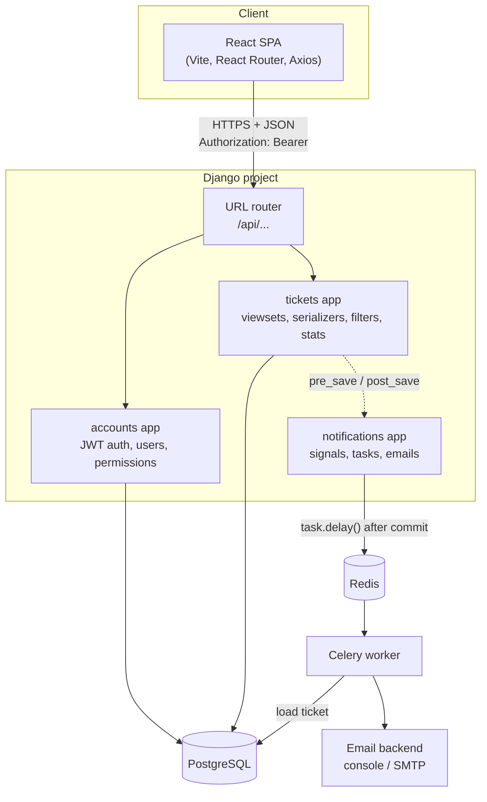
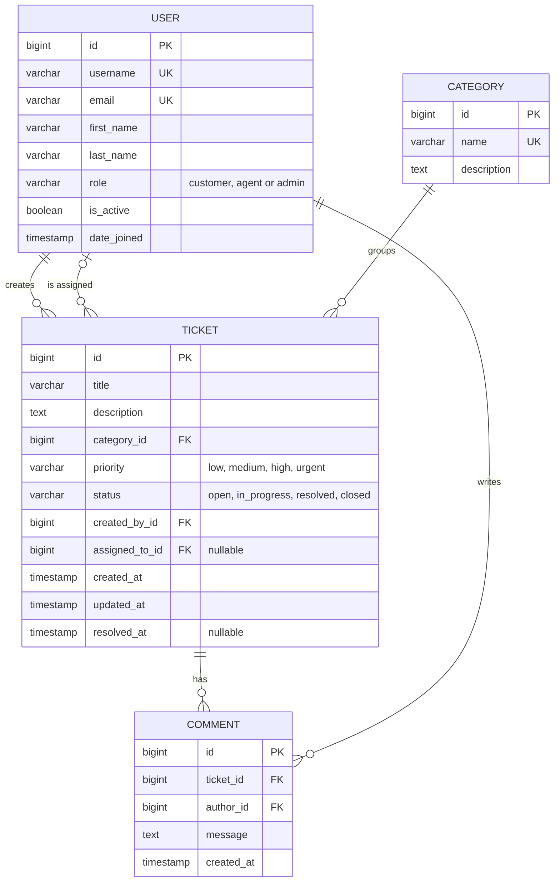
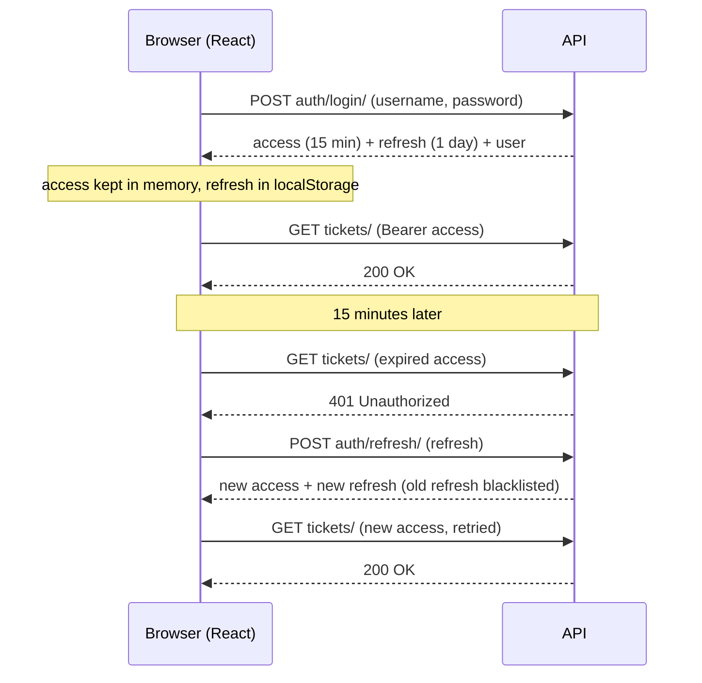
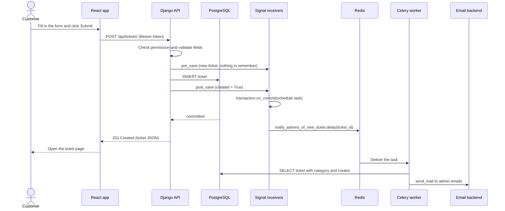
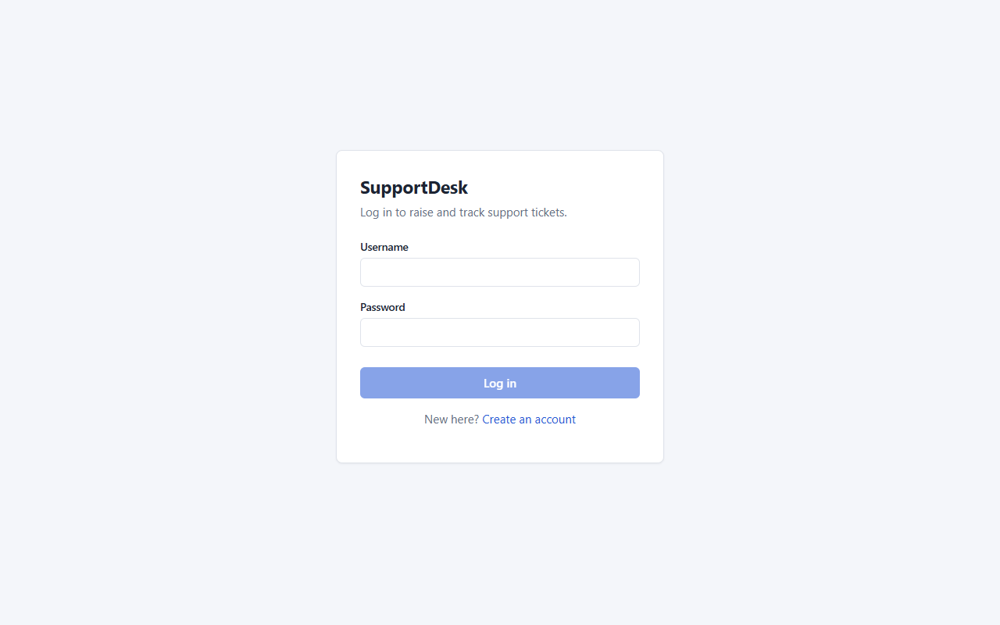
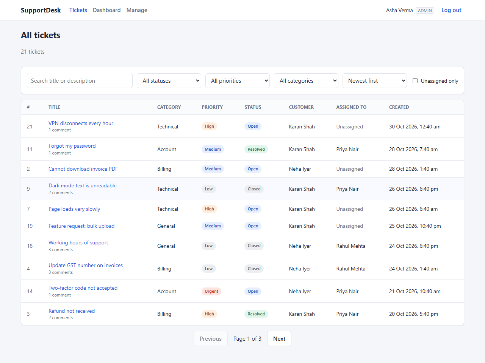
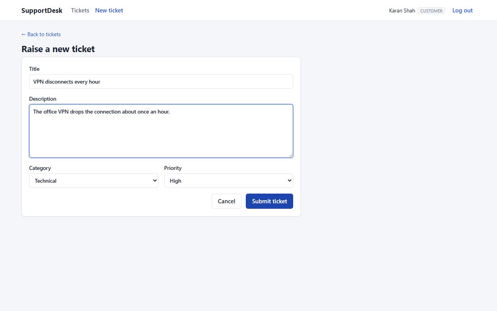
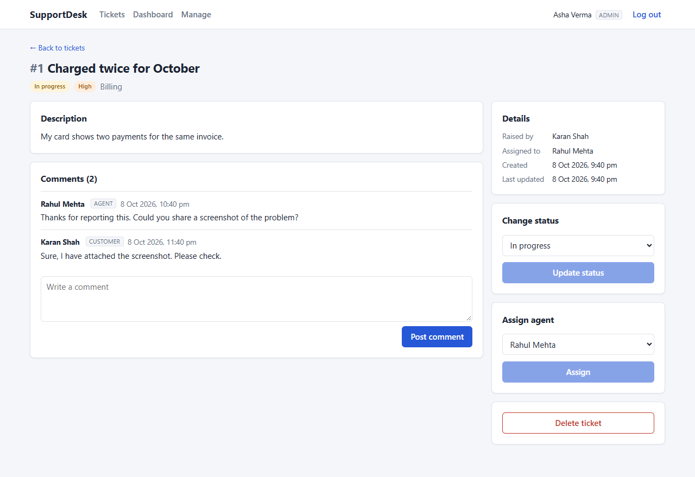
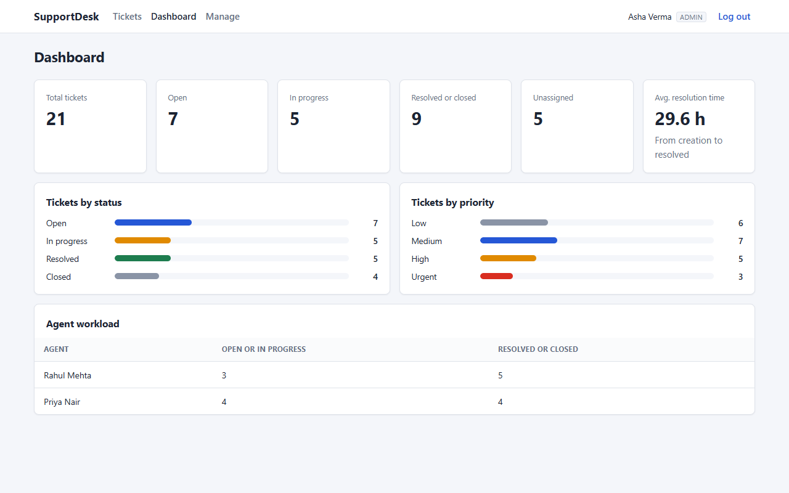
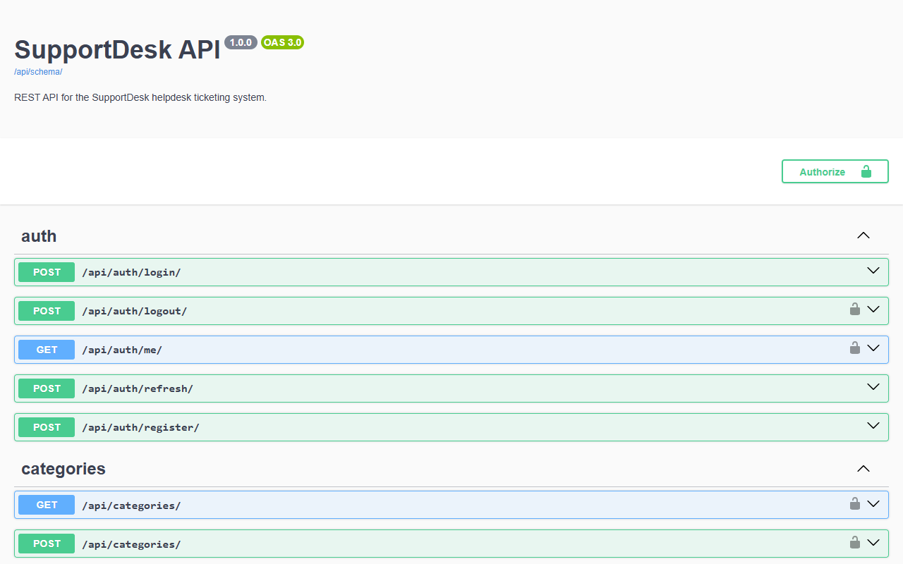

# SupportDesk: Project Report

**Helpdesk ticketing system with Django REST Framework, PostgreSQL, Celery, Redis and React**

Author: Aditya Kumar Singh, B.Tech CSE (final year)
Repository: https://github.com/aditya30-2005-eng/supportdesk

---

## Table of Contents

1. [Abstract](#1-abstract)
2. [Problem Statement](#2-problem-statement)
3. [Objectives](#3-objectives)
4. [Scope of the Project](#4-scope-of-the-project)
5. [Technology Stack](#5-technology-stack)
6. [System Architecture](#6-system-architecture)
7. [Database Design](#7-database-design)
8. [Module Description](#8-module-description)
9. [API Design](#9-api-design)
10. [Authentication and Role-Based Access Control](#10-authentication-and-role-based-access-control)
11. [Event-Driven and Asynchronous Flow](#11-event-driven-and-asynchronous-flow)
12. [Frontend Design](#12-frontend-design)
13. [Testing](#13-testing)
14. [Security Measures](#14-security-measures)
15. [Challenges Faced and How They Were Solved](#15-challenges-faced-and-how-they-were-solved)
16. [Future Scope](#16-future-scope)
17. [Conclusion](#17-conclusion)
18. [References](#18-references)

---

## 1. Abstract

SupportDesk is a web-based helpdesk ticketing system. A customer raises a support ticket, an admin assigns it to a support agent, the agent works on it and updates its status, and the people involved get an email at each important step.

The backend is a REST API built with Django and Django REST Framework (DRF) on a PostgreSQL database. Login uses JSON Web Tokens (JWT). There are three roles: customer, agent and admin. Each role sees and changes only what it is allowed to, and this is checked on the server. Emails are sent in the background: Django signals detect the events, and Celery workers send the emails using Redis as the message broker. The frontend is a single-page React application built with Vite.

The project has 58 automated backend tests, all passing on the last run. I also checked the main flows for all three roles in a real browser.

## 2. Problem Statement

Small teams often handle support requests through a shared email inbox or a chat group. This causes common problems:

- Requests get lost, and two people may answer the same request while another is never answered.
- There is no clear owner for a request and no clear status (new, being worked on, done).
- Customers do not know whether anyone is working on their problem.
- Managers cannot see how many requests are open or how long they take to resolve.
- Without access control, anyone can read every request, including other customers' private details.

A ticketing system solves this by turning each request into a record with an owner, a status, a history of comments and clear rules about who can see it.

## 3. Objectives

1. Let customers register, log in, raise tickets and follow their progress.
2. Let an admin assign each ticket to an agent, and let agents update the status.
3. Enforce role-based access on the server, so that a customer can never see another customer's ticket and an agent only sees their own assigned tickets.
4. Send email notifications for new tickets, assignments and status changes, without slowing down the API.
5. Send a status email only when the status really changes.
6. Give the admin a dashboard with ticket counts and the average resolution time.
7. Provide filtering, search, ordering and pagination on the ticket list.
8. Document the API with Swagger and cover the important behaviour with automated tests.

## 4. Scope of the Project

**In scope**

- Custom user model with three roles
- JWT login, token refresh with rotation, logout
- Ticket, category and comment management through a REST API
- Role-based permissions and per-role queryset filtering
- Event-driven email notifications through signals, Celery and Redis
- Admin dashboard statistics using the Django ORM
- React frontend for all three roles
- Demo data command, Docker Compose for the services, tests, CI workflow and a deployment blueprint

**Out of scope (for this version)**

- File attachments
- Real-time updates (WebSockets)
- Replying to tickets by email
- SLA rules and automatic escalation
- Multi-tenant support for several companies

## 5. Technology Stack

| Area | Tool | Version used | Why I chose it |
| --- | --- | --- | --- |
| Language | Python | 3.13 | Required for the role. Clear syntax and a large ecosystem. |
| Web framework | Django | 6.1 | Built-in ORM, migrations, admin site, auth and security features. |
| API | Django REST Framework | 3.18 | Serializers, viewsets, permission classes, pagination and filtering out of the box. |
| Auth | djangorestframework-simplejwt | 5.5 | Stateless JWT auth for a separate frontend, with refresh rotation and a blacklist. |
| Filtering | django-filter | 26.2 | Declarative filters on query parameters that plug into DRF. |
| CORS | django-cors-headers | 4.9 | The React dev server runs on a different port than the API. |
| API docs | drf-spectacular | 0.30 | Generates an OpenAPI 3 schema and Swagger UI from the code. |
| Config | python-dotenv, dj-database-url | 1.2, 3.1 | Keeps secrets in `.env` and the database in one URL. |
| Database | PostgreSQL | 17 | Reliable relational database. It supports interval arithmetic, which I use for the average resolution time. |
| DB driver | psycopg | 3.3 | The current PostgreSQL adapter supported by Django. |
| Task queue | Celery | 5.6 | Standard Python tool for background jobs with retries. |
| Broker | Redis | 7 | Simple and fast broker for Celery. |
| Frontend | React | 19 | Component-based UI. |
| Build tool | Vite | 8 | Fast dev server and production build. |
| Routing / HTTP | React Router, Axios | 7.18, 1.21 | Client-side routes, and Axios interceptors for adding and refreshing tokens. |
| Styling | Plain CSS | - | The project asked for no UI library. CSS variables keep the colours consistent. |
| Code quality | black, ruff, oxlint, Prettier | - | One consistent style for Python and JavaScript. |
| DevOps | Docker Compose, GitHub Actions, Render blueprint | - | Runs PostgreSQL and Redis locally; CI runs tests on every push; optional deployment. |

## 6. System Architecture



The system has three running parts:

1. **React app**: runs in the browser and only talks to the API.
2. **Django API**: handles HTTP requests, checks permissions and reads and writes PostgreSQL.
3. **Celery worker**: a separate process that takes tasks from Redis and sends emails.

The API never sends an email itself. It only puts a small message (the task name and the ticket id) on the Redis queue. This keeps requests fast, and a slow or failing mail server cannot break ticket creation.

## 7. Database Design

### 7.1 ER diagram



### 7.2 Tables

**`accounts_user`**: custom user model that extends Django's `AbstractUser`. I created it before the first migration, because changing the user model later is very hard in Django.

| Field | Type | Notes |
| --- | --- | --- |
| `username` | varchar(150), unique | Used to log in |
| `email` | varchar, unique | Made unique so that emails go to one person |
| `role` | varchar(20) | `customer` (default), `agent` or `admin` |
| other fields | from `AbstractUser` | password hash, names, `is_active`, `date_joined`, `last_login` |

`createsuperuser` sets `role=admin` automatically through a small custom manager.

**`tickets_category`**

| Field | Type | Notes |
| --- | --- | --- |
| `name` | varchar(100), unique | For example "Billing" |
| `description` | text, optional | |

**`tickets_ticket`**

| Field | Type | Notes |
| --- | --- | --- |
| `title` | varchar(200) | |
| `description` | text | |
| `category` | FK to category, `PROTECT` | A category that still has tickets cannot be deleted |
| `priority` | varchar(10) | Default `medium` |
| `status` | varchar(20) | Default `open` |
| `created_by` | FK to user, `CASCADE` | The customer |
| `assigned_to` | FK to user, nullable, `SET_NULL` | The agent |
| `created_at`, `updated_at` | timestamps | `auto_now_add` and `auto_now` |
| `resolved_at` | timestamp, nullable | Set when the ticket becomes resolved or closed, cleared if it is reopened |

I added `resolved_at` (it was not in the first plan) because the average resolution time cannot use `updated_at`: a comment or a priority change after resolving would change it.

Default ordering is newest first (`-created_at`). Indexes:

| Index | Why |
| --- | --- |
| `(status, priority)` | Admin list filtered by status and priority, and the dashboard counts |
| `(created_by, -created_at)` | A customer's own list, newest first |
| `(assigned_to, status)` | An agent's list, often filtered by status |

**`tickets_comment`**

| Field | Type | Notes |
| --- | --- | --- |
| `ticket` | FK to ticket, `CASCADE` | |
| `author` | FK to user, `CASCADE` | |
| `message` | text | |
| `created_at` | timestamp | Comments are ordered oldest first |

The `token_blacklist` tables from SimpleJWT store issued and blacklisted refresh tokens.

## 8. Module Description

### 8.1 `config` (project settings)

- `settings.py` reads everything secret or environment-specific from `.env`. It refuses to start without `DJANGO_SECRET_KEY`. When tests run, it switches to eager Celery tasks and the in-memory email backend. When debug is off, it turns on HTTPS-related security settings.
- `celery.py` creates the Celery app and loads every `CELERY_*` setting from Django settings.
- `urls.py` registers the routers for tickets, categories and users, plus the auth, dashboard and docs routes.
- `pagination.py` sets 10 items per page, and allows `?page_size=` up to 100.

### 8.2 `accounts`

- **Model:** `User` with a `role` field and helper properties `is_customer`, `is_agent` and `is_admin`.
- **Serializers:** `RegisterSerializer` validates the password with Django's password validators, checks that the email is unique (case-insensitive) and always creates a customer. `LoginSerializer` extends SimpleJWT's serializer to return the user together with the tokens, so the frontend does not need a second request after login. `AdminUserSerializer` lets an admin change only `role` and `is_active`.
- **Views:** register, login, refresh, logout (blacklists the refresh token), `me`, and an admin-only `UserViewSet`. An admin cannot change their own role or deactivate themselves, so they cannot lock themselves out.
- **Permissions:** `IsAdminRole`, `IsCustomerRole` and `IsAdminOrReadOnly`.
- **Throttling:** register and login are limited to 20 requests per minute per client.

### 8.3 `tickets`

- **Models:** `Category`, `Ticket`, `Comment`. `Ticket.save()` keeps `resolved_at` correct.
- **Serializers:** `TicketSerializer` checks which fields the current role may send. On create only title, description, category and priority are accepted. On update a customer may change the text fields while the ticket is open, an agent may change only `status`, and an admin may change status, priority and category. Any other field is rejected with a clear 400 error instead of being ignored silently. `TicketDetailSerializer` adds the comments.
- **Views:**
  - `tickets_visible_to(user)` is the single function that decides which tickets a user may see. All ticket actions (list, detail, update, delete, assign, comments) start from it, so another customer's ticket returns 404 everywhere.
  - `TicketViewSet` adds `select_related` for category, creator and assignee, annotates `comment_count` and `priority_rank`, and uses `prefetch_related` for comments with their authors on the detail page.
  - `assign` (admin only) and `comments` (GET and POST) are custom `@action` routes.
  - `DashboardStatsView` uses `aggregate` and `annotate` to compute everything in a few SQL queries.
  - `CategoryViewSet` is read-only for non-admins.
- **Filters:** status, priority, category, assignee, `unassigned`, and a created date range. Search covers title and description. Ordering is allowed on `created_at`, `updated_at`, `status` and `priority_rank`.
- **Management command:** `seed_demo` creates the demo users, 4 categories, 20 tickets and comments. It uses `bulk_create` for tickets so that no signals fire and no emails are sent while seeding.

### 8.4 `notifications`

- `signals.py`: a `pre_save` receiver reads the current status and assignee from the database and stores them on the instance. A `post_save` receiver compares them with the new values and schedules only the tasks that are needed. Tasks are scheduled with `transaction.on_commit`.
- `tasks.py`: three Celery tasks (`notify_admins_of_new_ticket`, `notify_agent_of_assignment`, `notify_customer_of_status_change`). Each one loads the ticket again by id, skips it if it was deleted, and retries up to 3 times with backoff on network or SMTP errors.
- `emails.py`: builds the subject, body and recipients, and calls `send_mail`. The email links point to the ticket page in the frontend.

### 8.5 `frontend`

- `api/client.js`: an Axios instance. A request interceptor adds the access token. A response interceptor catches a 401, refreshes the token once and retries the request.
- `auth/`: `AuthProvider` restores the session on page load, and exposes `login`, `logout` and the current user.
- `components/`: `Layout` (top bar with role-based links), `RequireAuth` (route guard with optional roles), `Badge`, `Pagination`, and loading, empty and error state components.
- `pages/`: login, register, ticket list, create ticket, ticket details, dashboard and manage (categories and users).
- `utils/`: labels for choices, date formatting, turning DRF error responses into messages, and a small `useFetch` hook used by every page that loads data.

## 9. API Design

Base URL: `/api/`. Swagger UI: `/api/docs/`. Schema: `/api/schema/`.

| Method | Endpoint | Customer | Agent | Admin | Description |
| --- | --- | --- | --- | --- | --- |
| POST | `auth/register/` | public | public | public | Create a customer account |
| POST | `auth/login/` | public | public | public | Get access and refresh tokens |
| POST | `auth/refresh/` | public | public | public | New access token (and a rotated refresh token) |
| POST | `auth/logout/` | yes | yes | yes | Blacklist the refresh token |
| GET | `auth/me/` | yes | yes | yes | Current user |
| GET | `tickets/` | own | assigned | all | Paginated list with filters, search and ordering |
| POST | `tickets/` | yes | no | no | Create a ticket |
| GET | `tickets/<id>/` | own | assigned | all | Ticket with comments |
| PATCH | `tickets/<id>/` | own, text fields while open | assigned, status only | status, priority, category | Update |
| DELETE | `tickets/<id>/` | no | no | yes | Delete |
| POST | `tickets/<id>/assign/` | no | no | yes | Assign to an active agent |
| GET, POST | `tickets/<id>/comments/` | own | assigned | all | List or add comments |
| GET | `categories/` | yes | yes | yes | All categories (not paginated) |
| POST, PUT, PATCH, DELETE | `categories/...` | no | no | yes | Manage categories |
| GET, PATCH | `users/`, `users/<id>/` | no | no | yes | List users, change role or active status |
| GET | `dashboard/stats/` | no | no | yes | Dashboard numbers |

"no" means 403 Forbidden. A ticket outside the user's visible set returns 404 Not Found, so the API does not reveal that the ticket exists. `PUT` on tickets is disabled (405) because all ticket updates are partial.

### 9.1 Sample requests and responses

These match the real response shapes from the running API. Tokens are shortened.

**Login**

```http
POST /api/auth/login/
Content-Type: application/json

{"username": "customer1", "password": "Demo@12345"}
```

```json
{
  "refresh": "eyJhbGciOi...",
  "access": "eyJhbGciOi...",
  "user": {
    "id": 4,
    "username": "customer1",
    "email": "customer1@supportdesk.local",
    "first_name": "Karan",
    "last_name": "Shah",
    "full_name": "Karan Shah",
    "role": "customer"
  }
}
```

**Create a ticket**

```http
POST /api/tickets/
Authorization: Bearer eyJhbGciOi...
Content-Type: application/json

{"title": "Printer not working", "description": "It shows a paper jam", "category": 1, "priority": "high"}
```

```json
{
  "id": 21,
  "title": "Printer not working",
  "description": "It shows a paper jam",
  "category": 1,
  "category_name": "Billing",
  "priority": "high",
  "status": "open",
  "created_by": {"id": 4, "username": "customer1", "full_name": "Karan Shah", "role": "customer", "...": "..."},
  "assigned_to": null,
  "comment_count": 0,
  "created_at": "2026-10-29T18:49:08.874990Z",
  "updated_at": "2026-10-29T18:49:08.874990Z",
  "resolved_at": null
}
```

**A customer trying to change the status**

```http
PATCH /api/tickets/21/
{"status": "closed"}
```

```json
HTTP 400
{"status": ["You are not allowed to set this field."]}
```

**Dashboard stats** (from the seeded demo data plus one extra ticket)

```json
{
  "total": 21,
  "unassigned": 5,
  "by_status": {"open": 7, "in_progress": 5, "resolved": 5, "closed": 4},
  "by_priority": {"low": 6, "medium": 7, "high": 5, "urgent": 3},
  "average_resolution_hours": 29.6,
  "agents": [
    {"id": 2, "username": "agent1", "full_name": "Rahul Mehta", "open_tickets": 4, "done_tickets": 5},
    {"id": 3, "username": "agent2", "full_name": "Priya Nair", "open_tickets": 3, "done_tickets": 4}
  ]
}
```

### 9.2 Avoiding N+1 queries

Each ticket in the list shows its category, creator and assignee. Without care, that is one query for the list plus three queries for every row. The list view uses:

```python
tickets_visible_to(user)
    .select_related("category", "created_by", "assigned_to")
    .annotate(comment_count=Count("comments"), priority_rank=PRIORITY_RANK)
```

`select_related` joins the foreign keys into the same query, and the comment count is computed by SQL. The detail page also uses `prefetch_related` for the comments and their authors (two queries in total for them). A test (`test_list_uses_a_fixed_number_of_queries`) asserts that the list endpoint runs exactly 2 queries (one `COUNT` for pagination and one for the page) whatever the number of tickets.

### 9.3 Dashboard queries

```python
Ticket.objects.aggregate(
    total=Count("id"),
    unassigned=Count("id", filter=Q(assigned_to__isnull=True)),
    average_resolution=Avg(
        ExpressionWrapper(F("resolved_at") - F("created_at"), output_field=DurationField()),
        filter=Q(resolved_at__isnull=False),
    ),
)
Ticket.objects.values("status").annotate(count=Count("id"))
```

PostgreSQL subtracts the two timestamps to get an interval and averages it in the database. The agent workload uses `annotate` with filtered `Count`s on the reverse relation `assigned_tickets`.

## 10. Authentication and Role-Based Access Control

### 10.1 JWT flow



- **Access token:** 15 minutes. It is kept only in a JavaScript variable, so it is not saved anywhere on disk.
- **Refresh token:** 1 day, saved in `localStorage` so that a page reload keeps the user logged in. Every refresh returns a new refresh token and blacklists the old one (`ROTATE_REFRESH_TOKENS` and `BLACKLIST_AFTER_ROTATION`), so a stolen refresh token works only once.
- **Logout** blacklists the current refresh token on the server and clears it in the browser.
- If several requests get a 401 at the same time, they all wait for **one** shared refresh request. This matters because, with rotation, a refresh token can be used only once.

Storing the refresh token in `localStorage` means a successful XSS attack could read it. An httpOnly cookie would be safer, but it needs CSRF handling between two origins. I chose the simpler approach for this version, kept the access token in memory, and listed the cookie approach under future scope.

### 10.2 Role rules

Access is checked in three layers on the server:

| Layer | What it does | Example |
| --- | --- | --- |
| Permission classes | Who can call an action at all | `IsCustomerRole` on create, `IsAdminRole` on delete, assign, users and dashboard |
| Queryset filtering | Which rows a user can reach | `tickets_visible_to(user)`; other tickets return 404 |
| Serializer validation | Which fields a role can change | Agent can only send `status`; customer cannot send `status` |

The frontend also hides buttons and routes based on the role (for example the Dashboard link and the Assign form), but this is only for a better experience. Every rule above holds even if someone calls the API directly, and the tests check this by calling the API.

## 11. Event-Driven and Asynchronous Flow

### 11.1 Events

| Event | How it is detected | Task | Who gets the email |
| --- | --- | --- | --- |
| Ticket created | `post_save` with `created=True` | `notify_admins_of_new_ticket` | All active admins |
| Ticket assigned | `assigned_to` differs from the value saved before | `notify_agent_of_assignment` | The new agent |
| Status changed | `status` differs from the value saved before | `notify_customer_of_status_change` | The customer who raised it |

Saving a ticket without changing its status (for example changing only the priority) sends no email. Assigning a ticket again to the same agent sends no email either. Both cases have tests.

### 11.2 Sequence: customer creates a ticket



### 11.3 Design decisions

- **`transaction.on_commit`:** the task is put on the queue only after the database transaction commits. If it were queued earlier, the worker could look for a ticket that is not saved yet, or send an email for a change that was rolled back.
- **Only the id is sent to the task**, not the whole object. The worker loads fresh data, and the message stays small and JSON-friendly.
- **Retries:** tasks retry up to 3 times with exponential backoff on `OSError` (SMTP errors are a subclass of it).
- **`acks_late`** with a 60-second time limit, so a task is not lost if the worker crashes in the middle.
- **Windows:** Celery's default prefork pool does not work on Windows, so the worker is started with `--pool=solo` there.
- **No Redis:** setting `CELERY_TASK_ALWAYS_EAGER=True` runs the tasks inside the Django process. The tests use this too.

I checked this flow by hand with the API server, a Celery worker (`--pool=solo` on Windows) and Redis in Docker. Creating a ticket, assigning it and changing its status produced exactly three emails in the worker log, and a second PATCH with the same status produced none.

## 12. Frontend Design

The frontend is a React single-page app with plain CSS. It uses a light colour scheme, coloured badges for status and priority, and cards. Layouts switch to one column below 860px. I checked that there is no horizontal page scroll at a 375px phone width.

| Page | Route | Roles | What it shows |
| --- | --- | --- | --- |
| Login | `/login` | public | Username and password, error for wrong details |
| Register | `/register` | public | Sign-up form with client-side checks and server error messages |
| Ticket list | `/tickets` | all | Table with badges, search (waits 400 ms after typing stops), status/priority/category filters, sort, "unassigned only" for admins, pagination. Filters live in the URL, so a filtered view can be bookmarked |
| Create ticket | `/tickets/new` | customer | Title, description, category and priority with validation |
| Ticket details | `/tickets/:id` | all with access | Description, details, comments, status form (agent and admin), assign form and delete (admin) |
| Dashboard | `/dashboard` | admin | Six stat cards, status and priority bars, agent workload table |
| Manage | `/manage` | admin | Add categories, change roles, activate or deactivate users |

Every page that loads data shows a loading spinner, an empty state when there is nothing to show, and an error message with a "Try again" button when a request fails.

### Screenshots

**Login**



**Ticket list (admin)**



**Create ticket (customer)**



**Ticket details (admin view, with status and assign forms)**



**Admin dashboard**



**Swagger API docs**



## 13. Testing

### 13.1 Automated backend tests

The tests use Django's test runner with DRF's `APITestCase` on a real PostgreSQL test database. During tests, Celery runs tasks eagerly (`CELERY_TASK_ALWAYS_EAGER`) and emails go to Django's in-memory `locmem` outbox. Signal tests use `captureOnCommitCallbacks(execute=True)` so the `on_commit` callbacks run inside the test transaction.

| Area | File | Tests | What is checked |
| --- | --- | --- | --- |
| Registration | `accounts/tests.py` | 3 | Always creates a customer even if `role=admin` is sent; duplicate email rejected; weak password rejected |
| Login and tokens | `accounts/tests.py` | 5 | Tokens and user returned; wrong password 401; `me` needs a token; refresh rotation makes the old token fail; logout blacklists |
| User management | `accounts/tests.py` | 4 | Only admin lists users; admin changes another user's role; admin cannot change own role; `createsuperuser` gets the admin role |
| Ticket create | `tickets/tests/test_tickets.py` | 5 | Customer creates; cannot set status on create; missing fields; agent and admin get 403; anonymous gets 401 |
| Visibility | `tickets/tests/test_tickets.py` | 5 | Customer sees own only; other customer's ticket is 404; agent sees assigned only; admin sees all; list runs exactly 2 queries |
| Ticket update and delete | `tickets/tests/test_tickets.py` | 8 | Agent changes status; agent cannot change title; other agent gets 404; customer cannot change status; customer edits only while open; PUT is 405; `resolved_at` set and cleared; only admin deletes |
| Assign | `tickets/tests/test_tickets.py` | 3 | Admin assigns; customer and agent get 403; cannot assign to a customer |
| Comments | `tickets/tests/test_tickets.py` | 4 | Customer and agent comment; no comments on hidden tickets; empty comment rejected; detail includes comments |
| Categories | `tickets/tests/test_tickets.py` | 2 | Everyone lists, only admin creates; category in use cannot be deleted |
| Filters and search | `tickets/tests/test_filters.py` | 7 | Status, priority + category, unassigned, search in title and description, priority ordering, invalid value gives 400, pagination |
| Dashboard | `tickets/tests/test_dashboard.py` | 4 | Counts and average (2 h and 4 h give 3.0 h); agent workload; null average; admin only |
| Signals and tasks | `notifications/tests.py` | 8 | New ticket emails admins; assign emails agent; status change emails customer; no email without a real change; no email on same agent; no email if the transaction does not commit; full API flow sends 3 emails in order; task skips a deleted ticket |
| **Total** | | **58** | |

**Result of the last run:**

```
$ python manage.py test
Found 58 test(s).
System check identified no issues (0 silenced).
..........................................................
----------------------------------------------------------------------
Ran 58 tests in 2.066s

OK
```

### 13.2 Other checks I ran

| Check | Command | Result |
| --- | --- | --- |
| Python lint | `ruff check .` | All checks passed |
| Python format | `black --check .` | No changes needed |
| Migrations up to date | `manage.py makemigrations --check --dry-run` | No changes detected |
| OpenAPI schema | `manage.py spectacular` | No warnings or errors (after the fixes in section 15) |
| Deploy check | `manage.py check --deploy` with debug off | Only 2 HSTS warnings (`INCLUDE_SUBDOMAINS` and `PRELOAD`), left off on purpose because they depend on the final domain |
| Frontend lint | `npm run lint` (oxlint) | No warnings |
| Frontend build | `npm run build` | Built; JS bundle 347.10 kB (110.82 kB gzip), CSS 7.77 kB |

### 13.3 Browser check

I also drove the running app (Django, Celery, Redis, Vite) in headless Microsoft Edge with a Playwright script that I kept outside the repository. It ran 26 checks and all passed. The checks included:

- wrong password shows an error
- create form shows 3 validation errors when submitted empty, then creates a ticket
- the session survives a page reload, using the refresh token
- a forced 401 makes the app refresh the token and retry
- a customer opening another customer's ticket sees the "no access" message
- a customer is redirected away from `/dashboard`
- an agent changes a status and does not see the assign form
- an admin searches, filters unassigned tickets and assigns one
- the dashboard shows six cards and the manage page lists users
- logout works
- no horizontal scroll at 375px width
- Swagger loads
- no browser console errors for any role

The screenshots in this report were taken during that run.

## 14. Security Measures

| Measure | Where |
| --- | --- |
| No secrets in the code. `DJANGO_SECRET_KEY` is required from the environment and there is no fallback value | `config/settings.py`, `.env.example` |
| `.env`, virtual environments, `node_modules` and build folders are git-ignored | `.gitignore` |
| Passwords hashed by Django (PBKDF2) and checked with Django's password validators on register | `RegisterSerializer` |
| Public sign-up can only create customers; roles are changed only by an admin | `RegisterSerializer.create` |
| Short-lived access tokens, refresh rotation, blacklist on rotation and logout | `SIMPLE_JWT` settings, `LogoutView` |
| Every endpoint requires login by default (`IsAuthenticated` as default permission) | `REST_FRAMEWORK` settings |
| Role checks in permission classes, row checks in querysets, field checks in serializers | `accounts/permissions.py`, `tickets/views.py`, `tickets/serializers.py` |
| Hidden tickets return 404, not 403, so their existence is not revealed | `tickets_visible_to` |
| Admins cannot remove their own admin role or deactivate themselves | `UserViewSet.perform_update` |
| Rate limiting on login and register (20 per minute) | `ScopedRateThrottle` |
| CORS limited to the frontend origin | `CORS_ALLOWED_ORIGINS` |
| With debug off: HTTPS redirect, secure cookies, HSTS, `nosniff` | end of `settings.py` |
| SQL injection avoided by using the ORM only (no raw SQL) | whole backend |
| React escapes all text output; no `dangerouslySetInnerHTML` | frontend |

## 15. Challenges Faced and How They Were Solved

These are the actual problems I ran into while building and testing this project.

**1. Database password failed although the Docker container was running.**
The first `migrate` failed with `password authentication failed for user "supportdesk"`. With `netstat` I found two processes listening on port 5432: Docker and a PostgreSQL server already installed on the machine for another project. Django was connecting to the local server, not the container. I mapped the container to host port **5433** in `docker-compose.yml` and updated `.env.example` and the default `DATABASE_URL`. I left the existing PostgreSQL server alone.

**2. Swagger schema warnings.**
`manage.py spectacular` reported 15 warnings and 4 errors. Three causes:
- During schema generation there is no logged-in user, so `get_queryset` crashed on `AnonymousUser.is_admin`. I return `Ticket.objects.none()` when `swagger_fake_view` is set and added `queryset = Ticket.objects.none()` to the viewset.
- `DashboardStatsView` is a plain `APIView`, so the response shape could not be guessed. I added a `DashboardStatsSerializer` used only to describe the response.
- `get_full_name` had no return type, so I added `-> str`.

After that the schema generated with no warnings.

**3. Sorting by priority was alphabetical.**
Priority is stored as text, so `ordering=priority` would sort "high, low, medium, urgent". I annotated a `priority_rank` with `Case`/`When` (low=1 to urgent=4) and allowed ordering by it. A test checks that "highest priority first" returns urgent, then high, then low.

**4. Emails must not be queued before the ticket is saved.**
If a task is queued inside an open transaction, the worker may read the database before the commit. I wrapped every `delay()` in `transaction.on_commit`. Because Django's `TestCase` wraps each test in a transaction that is never committed, the signal tests use `captureOnCommitCallbacks(execute=True)` to run the callbacks. One test checks that nothing is sent when the callbacks are not run, which is what happens on a rollback.

**5. Seeding should not send 20 emails, and dates could not be set.**
`seed_demo` creates tickets with `bulk_create`, which does not send `post_save`, so no tasks are queued. But `auto_now_add` always sets `created_at` to "now". In the first screenshots all seeded comments showed today's date, after the ticket dates. I fixed it by setting the dates afterwards with `QuerySet.update()`, which writes the values directly. I also fixed the comment order, so the agent asks first and the customer answers.

**6. Repeated loading code in React and lint warnings.**
oxlint warned about calling `setState` directly inside effects on five pages, which all repeated the same load, error and retry code. I moved this into a small `useFetch` hook. I also moved the search delay from an effect into the input's change handler, using a timer kept in a `useRef`.

**7. Token refresh with rotation.**
With refresh rotation, a refresh token works only once. In development, React StrictMode runs effects twice, and a page can send several requests at once that all get a 401. Separate refresh calls would make the second one fail and log the user out. The client keeps one shared refresh promise that every caller waits on. The browser checks confirm that reloading keeps the session and that a forced 401 is refreshed and retried.

**8. Deleting a category that still has tickets caused a server error.**
While writing the README I checked each endpoint again and saw that `Ticket.category` uses `on_delete=PROTECT`. Deleting a category in use would raise `ProtectedError` and return a 500 error. `CategoryViewSet.perform_destroy` now turns it into a 400 with a clear message, and a test covers it.

## 16. Future Scope

- File attachments on tickets and comments, stored in object storage
- Real-time updates with Django Channels and WebSockets
- Turning email replies into comments
- SLA targets per priority, with Celery beat reminders and escalation
- Internal agent notes that customers cannot see
- Ticket history (audit log) showing who changed what and when
- Refresh token in an httpOnly, SameSite cookie
- Frontend tests with Vitest and React Testing Library, and browser tests in CI
- Full-text search with PostgreSQL `SearchVector` for large numbers of tickets
- Deploying the Render blueprint and adding error monitoring

## 17. Conclusion

SupportDesk does what I set out to build. Customers can raise and follow tickets, admins can assign them, agents can work on them, and email notifications go out through an event-driven, asynchronous pipeline. While building it I practised the main parts of backend work with Django:

- a custom user model and JWT authentication
- role-based access enforced in permissions, querysets and serializers
- ORM features such as `select_related`, `prefetch_related`, `annotate`, `aggregate`, `Case`/`When` and indexes
- signals with `on_commit`, and Celery tasks with retries
- generated API documentation
- automated tests for permissions and side effects

The React frontend uses the API for all three roles and handles token refresh, loading and errors.

The 58 backend tests, the lint and build checks, and the browser checks all passed on the last run.

## 18. References

- Django documentation: https://docs.djangoproject.com/
- Django custom user model: https://docs.djangoproject.com/en/stable/topics/auth/customizing/#substituting-a-custom-user-model
- Django signals: https://docs.djangoproject.com/en/stable/topics/signals/
- Django `transaction.on_commit`: https://docs.djangoproject.com/en/stable/topics/db/transactions/#performing-actions-after-commit
- Django database optimization: https://docs.djangoproject.com/en/stable/topics/db/optimization/
- Django aggregation: https://docs.djangoproject.com/en/stable/topics/db/aggregation/
- Django REST Framework: https://www.django-rest-framework.org/
- DRF permissions: https://www.django-rest-framework.org/api-guide/permissions/
- DRF testing: https://www.django-rest-framework.org/api-guide/testing/
- Simple JWT: https://django-rest-framework-simplejwt.readthedocs.io/
- django-filter: https://django-filter.readthedocs.io/
- drf-spectacular: https://drf-spectacular.readthedocs.io/
- django-cors-headers: https://github.com/adamchainz/django-cors-headers
- Celery with Django: https://docs.celeryq.dev/en/stable/django/first-steps-with-django.html
- Redis: https://redis.io/docs/
- PostgreSQL: https://www.postgresql.org/docs/
- psycopg 3: https://www.psycopg.org/psycopg3/docs/
- React: https://react.dev/
- Vite: https://vite.dev/
- React Router: https://reactrouter.com/
- Axios interceptors: https://axios-http.com/docs/interceptors
- Docker Compose: https://docs.docker.com/compose/
- Render Blueprints: https://render.com/docs/blueprint-spec
- OWASP REST Security Cheat Sheet: https://cheatsheetseries.owasp.org/cheatsheets/REST_Security_Cheat_Sheet.html
